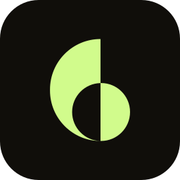

<p align="center">
  
</p>

<h1 align="center">Buildflow</h1>

<p align="center"><b>See how a website, app or game works, then have AI build your own version. Free, on your own computer, with the AI you already have.</b></p>

Buildflow is part of the FlowApps suite. It is a fork of
[Craft Anything](https://github.com/storytold/craft-anything) by the ArtCraft Team, with our own
name, look and defaults. Everything it can do comes from their work; see [Credits](#credits).

> Early alpha, like the project it is built on. Expect rough edges.

## What it does

- **Study.** Point it at a website, an app, a game or a file. It looks at the original with real
  inspection tools and keeps evidence for what it finds.
- **Build.** An AI builds a new project in the language or framework you ask for.
- **Check.** It compares the build with the original (a website's pages at three screen widths, for
  example) and refines it.
- **Clean room by default.** It only looks at the original from the outside, the way a visitor or
  user would. Deep mode, which looks inside programs, is off unless you turn it on.

## Use the AI you have

Add one in Settings → AI. Your keys stay in your computer's keychain.

| You have | Choose |
|---|---|
| A Claude, OpenAI, Gemini or OpenRouter key | That provider, then paste the key |
| An NVIDIA NIM key | NVIDIA NIM (or set `NVIDIA_API_KEY`) |
| A model running on your computer or network (Ollama, LM Studio, llama.cpp, vLLM) | Local / OpenAI-compatible server, then its address |
| Claude Code, Codex, Copilot, Gemini CLI, OpenCode, Hermes Agent or another coding agent installed | Agent app |

Building works best with a strong model. Small local models can answer questions about a target
but often can't finish a build.

## Use it well

Only study and rebuild things you have the right to. Building your own version of how something
works is not the same as copying its code, artwork, name or content: those belong to their owners.

## Download and install

**Easiest:** install and update Buildflow with the
[FlowApps launcher](https://github.com/reachneoagent-commits/FlowApps-Launcher/releases/latest).
Or pick a file from the [latest release](https://github.com/reachneoagent-commits/buildflow/releases/latest):

| Platform | File |
|---|---|
| macOS (Apple silicon and Intel) | `buildflow-<version>-macos-universal.dmg` |
| Windows x64 or ARM64 | `buildflow-<version>-windows-<arch>.msi` |
| Windows, no install | `buildflow-<version>-windows-<arch>-portable.zip` |

The app is not code-signed with a paid certificate, so macOS and Windows warn you the first time
you open it.

## Build from source

Needs Rust 1.97 or newer.

```bash
cargo run --release -p craft-anything
```

The crates and binaries keep upstream's `craft-anything` names so their updates merge cleanly.

## Keeping up with upstream

Upstream releases often. How we merge their updates and re-apply our branding is in
[docs/UPSTREAM.md](docs/UPSTREAM.md).

## Credits

Buildflow is built on [Craft Anything](https://github.com/storytold/craft-anything),
copyright the ArtCraft Team and the Craft Anything contributors, used under the MIT or Apache-2.0
license ([LICENSE-MIT](LICENSE-MIT), [LICENSE-APACHE](LICENSE-APACHE), [NOTICE](NOTICE),
[ATTRIBUTION.md](ATTRIBUTION.md)). Buildflow is not affiliated with or endorsed by the ArtCraft
Team. ArtCraft and Craft Anything are their names; the Buildflow name and mark are ours.
